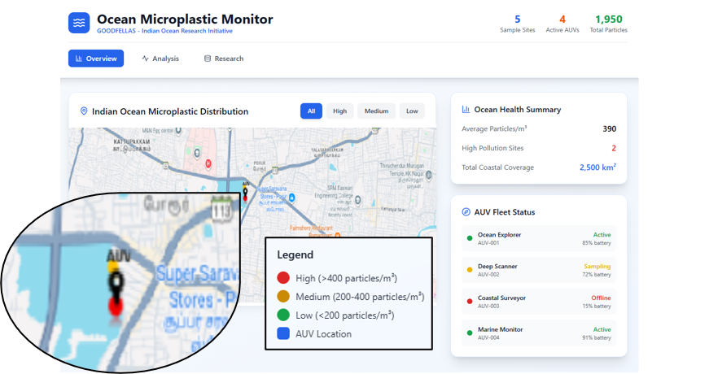
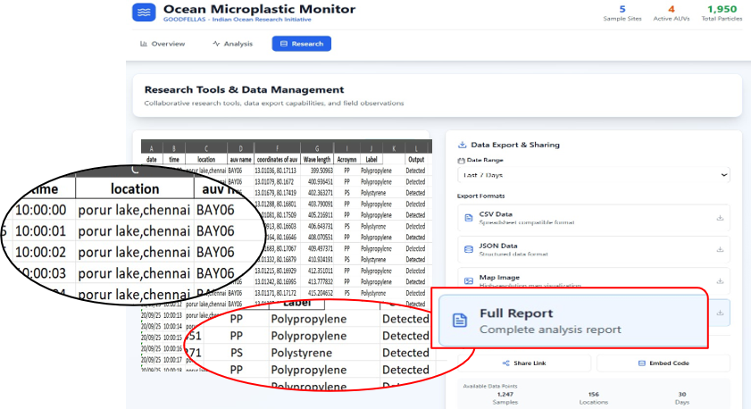
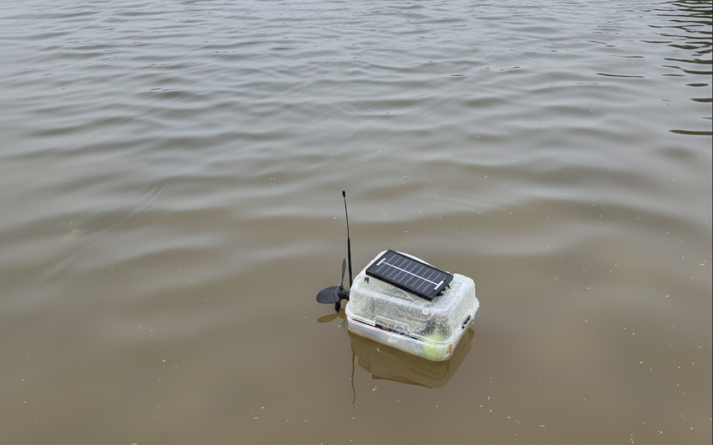

# Microplastic Detection AUV

Prototype software and notes for an AUV payload that records optical measurements and water samples. This repository focuses on the latest payload concept rather than vehicle-wide mechanical design.

## System boundary

- **Dedicated ArduSub-compatible autopilot:** sole authority for propulsion, depth/attitude control, arming, failsafes, and vehicle navigation.
- **Raspberry Pi 4:** samples the SparkFun AS7265X and ADS1115/LDR, timestamps and logs measurements, reads MAVLink telemetry, and optionally publishes data over MQTT when connectivity exists.
- **ESP32 DevKit V2:** controls sampler pump and laser through external drivers, with a hard pump timeout. It does not control thrusters.
- **Surface link:** GSM/LTE/Wi-Fi/GPS equipment must be at the surface or on a float; cellular and GNSS are not expected to work submerged. The payload logger works offline.

The included MAVLink client is receive-only. It sends no arming, mode, mission, setpoint, actuator, or parameter messages. Do not use this payload software as a flight controller.

## Repository map

```text
firmware/esp32_sampler/       ESP32 pump/laser controller
software/auv_logger/          Raspberry Pi acquisition and logging package
software/src/auv_logger/dashboard/  Local dashboard and prototype image
config/                       Example configuration (no credentials)
docs/                         Wiring, architecture, safety, tests, design report
```

## Hardware summary

The payload configuration uses an ESP32 DevKit V2, Raspberry Pi 4, SparkFun AS7265X Qwiic spectral triad, ADS1115 ADC, analog-output LDR module, and externally driven pump and laser. Vehicle movement remains with a separately selected and configured ArduSub-compatible autopilot.

See [wiring and integration](docs/wiring-and-integration.md) before connecting hardware. Raspberry Pi GPIO is 3.3 V and not 5 V tolerant; keep all sensor outputs within the Pi/ADC input rating. SparkFun identifies the Triad as 3.3 V compatible. [SparkFun hookup guide](https://learn.sparkfun.com/tutorials/spectral-triad-as7265x-hookup-guide/hardware-overview), [Raspberry Pi GPIO documentation](https://www.raspberrypi.com/documentation/computers/raspberry-pi.html).

## Quick start (Raspberry Pi)

Use Raspberry Pi OS 64-bit and Python 3.10 or newer. Enable I2C in `raspi-config`, attach the I2C devices, then:

```bash
cd software
python -m venv .venv
. .venv/bin/activate
pip install -e .
cp ../config/config.example.yaml ../config/config.yaml
auv-logger --config ../config/config.yaml doctor
```

Review `config/config.yaml`, especially serial port, sensor addresses, and the optional sections. Start acquisition with:

```bash
auv-logger --config ../config/config.yaml run
```

The logger creates its SQLite database and CSV export directory as configured. MQTT is disabled unless enabled in config and credentials are supplied through environment variables. For testing without hardware use `--dry-run`.

## Local live dashboard

Run the logger in one terminal, then start the dashboard in another:

```bash
auv-logger --config ../config/config.yaml run
auv-logger --config ../config/config.yaml dashboard
```

Open `http://127.0.0.1:8080`. The page refreshes from the same SQLite database every five seconds and displays sample time, ID, vehicle, available spectral channel count, and descriptive peak wavelength. The API is read-only. Bind to another address only on a trusted, access-controlled network: `auv-logger --config ../config/config.yaml --host 0.0.0.0 dashboard`.

Dry-run logger records are marked `SIMULATION`. The attached overview/research screenshots are design references, and the prototype photo is user supplied. None are live sensor observations. The dashboard does not classify particles or report a validated concentration. See [dashboard notes](docs/dashboard.md).

## ESP32 firmware

Open `firmware/esp32_sampler/esp32_sampler.ino` in Arduino IDE, select the ESP32 Dev Module, inspect the GPIO/polarity constants, and flash with pump and laser disconnected. The serial protocol and hardware checks are in [wiring and integration](docs/wiring-and-integration.md). Confirm the outputs stay off after reset and on serial disconnect before connecting drivers.

## Data and commands

The Pi sends newline-delimited `SAMPLE_START,<id>,<pump_ms>` and `MEASURE_DONE,<id>` messages at 115200 baud over USB serial. ESP32 responses are newline-delimited `ACK`, `EVENT`, or `ERROR` records. Samples include UTC time, 18 spectral channels, LDR ADC voltage, sample ID, and any latest autopilot telemetry. See [data format](docs/data-format.md).

## Documentation

- [Architecture and mechanical integration](docs/architecture-and-design.md)
- [Wiring and integration](docs/wiring-and-integration.md)
- [Safety and operating limits](docs/safety.md)
- [Commissioning and test plan](docs/test-plan.md)
- [Project report](docs/project-report.md)
- [Data format](docs/data-format.md)
- [Hardware and software references](docs/references.md)

## Known limitations

AS7265X channels and LDR readings are optical measurements, not a validated microplastic identification result. Establish dark/reference standards, repeatability, particle-size response, water-matrix effects, and laboratory ground truth before reporting concentrations or species. GNSS position is only available at the surface; underwater position is estimated by the autopilot and depends on installed sensors and tuning. GSM/MQTT delivery is opportunistic. The dashboard is local and does not provide cloud hosting or user authentication.

## Safety

Bench-test with propellers removed and pump/laser loads disconnected. Use a sealed, pressure-rated housing and test it separately before electronics are installed. Never put a Li-ion pack or unsealed electronics in water. Keep a topside operator and an independent recovery method. Review [safety notes](docs/safety.md) and the test plan before any wet run.

## License

No license has been selected. Until the project owner adds one, all rights are reserved by default; do not assume permission to reuse or redistribute this repository.

## Ocean Microplastic Monitor






